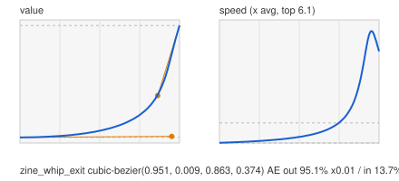
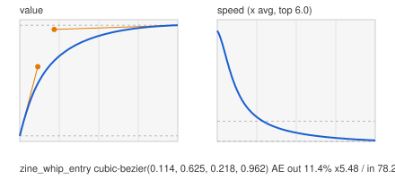
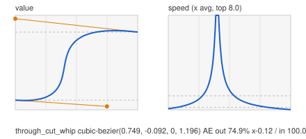
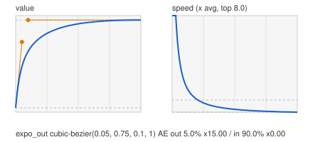
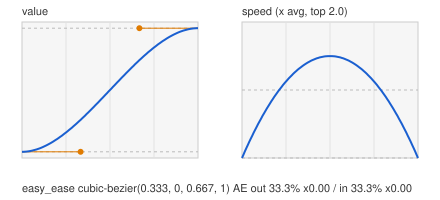

# Bezier eases in AE: from four numbers to keyframe influence and speed

Flow, CSS `cubic-bezier()` and most curve editors describe an ease with four numbers, `x1, y1, x2, y2`: the two
handles of a bezier on a 0..1 time / 0..1 value square. After Effects stores the same curve differently, as an
**influence** (handle length, % of the segment) and a **speed** (units per second) on each key. This page shows how
the two map onto each other and how `utils/graph_lib.jsx` does it for you.

## The conversion

For a move from `v0` to `v1` over `dur` seconds, the average speed is `avg = (v1 - v0) / dur`.

| | Influence | Speed |
|---|---|---|
| key 1, outgoing | `x1 * 100` | `(y1 / x1) * avg` |
| key 2, incoming | `(1 - x2) * 100` | `((1 - y2) / (1 - x2)) * avg` |

And back again:

```
x1 = outInfluence / 100            y1 = (outSpeed / avg) * x1
x2 = 1 - inInfluence / 100         y2 = 1 - (inSpeed / avg) * (inInfluence / 100)
```

Three things fall out of this:

- A curve with `y1 = 0` and `y2 = 1` is just two influences with speed 0. AE's Easy Ease (F9) is
  `0.333, 0, 0.667, 1`: 33.3 % out, 33.3 % in.
- `y` outside 0..1 means a negative speed, which AE draws as overshoot. That works on 1D and separated
  properties. A **spatial** property (Position without Separate Dimensions) stores speed as a magnitude, so it
  cannot overshoot this way; use `glExpr()` there.
- The speeds scale with the move, the four numbers don't. Because `bezierToAE()` returns speed as a ratio of
  `avg`, one curve fits any distance and duration.

AE clamps influence to 0.1..100 %. A handle with zero length (`x1 = 0` or `x2 = 1`, for example `linear`) has no
defined speed; the helpers give it 0.1 % influence and speed 0, which AE draws as a straight line into the key.

## The helpers

```js
$.evalFile(new File("~/Projects/ae-motion-toolkit/utils/graph_lib.jsx"));
var pos = layer.property("ADBE Transform Group").property("ADBE Position");

// keys you already have: ease key 1 -> key 2 with numbers copied from Flow or CSS
bezierEase(pos, 1, 2, [0.29, 0.81, 0.21, 1.04]);

// or a named family (k2 defaults to k1 + 1)
bezierEase(layer.property("ADBE Transform Group").property("ADBE Scale"), 3, null, "zine_whip_exit");

// the other way: read the curve you hand-made in the graph editor
var b = aeKeysToBezier(pos, 1, 2);      // [x1, y1, x2, y2], ready to paste into Flow or GL_FAM

// just the numbers, no property
bezierToAE([0.05, 0.75, 0.10, 1.0]);   // [5, 15, 90, 0] -> out 5 % at 15x avg speed, in 90 % at speed 0
aeToBezier(5, 15, 90, 0);               // [0.05, 0.75, 0.1, 1]
```

`bezierEase()` only touches the outgoing side of `k1` and the incoming side of `k2`, so you can ease a chain of keys
one segment at a time. On multi-dimension properties (Scale, separated Position) each dimension gets its own speed
with its own sign, so the curve shape is the same on every axis. `glKey()` and `glKey3()` create the keys and ease
them in one call; `bezierEase()` is for keys that are already there.

## The families

Each picture has two panels: the value graph with the bezier handles in orange, and the speed graph as a multiple
of the average speed (1.0 = linear). The speed graph is what AE's Speed Graph shows, and it is where "peak speed on
the cut" or "starts at full speed" is easy to see.

| Family | cubic-bezier | AE out (influence, speed x avg) | AE in (influence, speed x avg) | Picture |
|---|---|---|---|---|
| `zine_whip_entry` | `0.114, 0.625, 0.218, 0.962` | 11.4 %, 5.48 | 78.2 %, 0.05 | [svg](img/ease_zine_whip_entry.svg) |
| `zine_whip_exit` | `0.951, 0.009, 0.863, 0.374` | 95.1 %, 0.01 | 13.7 %, 4.57 | [svg](img/ease_zine_whip_exit.svg) |
| `zine_snap_step` | `0.292, 0.809, 0.212, 1.039` | 29.2 %, 2.77 | 78.8 %, -0.05 | [svg](img/ease_zine_snap_step.svg) |
| `through_cut_whip` | `0.749, -0.092, 0, 1.196` | 74.9 %, -0.12 | 100.0 %, -0.20 | [svg](img/ease_through_cut_whip.svg) |
| `ui_tilt_s` | `0.782, 0.16, 0.146, 1.039` | 78.2 %, 0.20 | 85.4 %, -0.05 | [svg](img/ease_ui_tilt_s.svg) |
| `ios_scroll` | `0.384, 0.269, 0.006, 1.041` | 38.4 %, 0.70 | 99.4 %, -0.04 | [svg](img/ease_ios_scroll.svg) |
| `droste_linear` | `0.382, 0.48, 0.653, 0.305` | 38.2 %, 1.26 | 34.7 %, 2.00 | [svg](img/ease_droste_linear.svg) |
| `expo_out` | `0.05, 0.75, 0.1, 1` | 5.0 %, 15.00 | 90.0 %, 0.00 | [svg](img/ease_expo_out.svg) |
| `flow_051` | `0.51, 0, 0, 1` | 51.0 %, 0.00 | 100.0 %, 0.00 | [svg](img/ease_flow_051.svg) |
| `house_30_90` | `0.3, 0, 0.1, 1` | 30.0 %, 0.00 | 90.0 %, 0.00 | [svg](img/ease_house_30_90.svg) |
| `easy_ease` | `0.333, 0, 0.667, 1` | 33.3 %, 0.00 | 33.3 %, 0.00 | [svg](img/ease_easy_ease.svg) |
| `linear` | `0, 0, 1, 1` | 0.1 %, 0.00 | 0.1 %, 0.00 | [svg](img/ease_linear.svg) |

A few side by side:

**Into a cut** (`zine_whip_exit`): almost no travel for most of the segment, then full speed on the last frame.



**Out of a cut** (`zine_whip_entry`): the mirror image, starts at peak speed and settles.



**One move across the cut** (`through_cut_whip`): a small pull back, peak speed near 40 %, then overshoot. The
negative speeds in the table are that pull back and overshoot.



**Expo out** (`expo_out`): 15x the average speed on the first frame, 80 % of the travel in the first few frames.



**AE Easy Ease** (`easy_ease`) for comparison.



## Regenerating the pictures

The SVGs and the table come from the `GL_FAM` block in `utils/graph_lib.jsx`. After adding or changing a family:

```
python3 docs/tools/plot_eases.py      # rewrites docs/img/ease_*.svg and prints the table above
node docs/tools/check_bezier_ease.js  # checks the conversion helpers outside AE
```

Both use only the Python standard library and plain Node.
